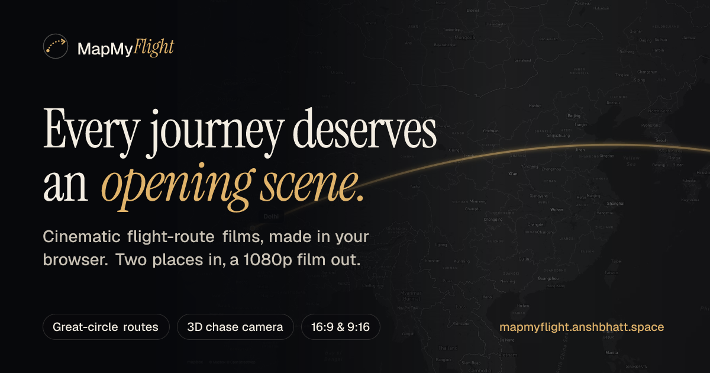
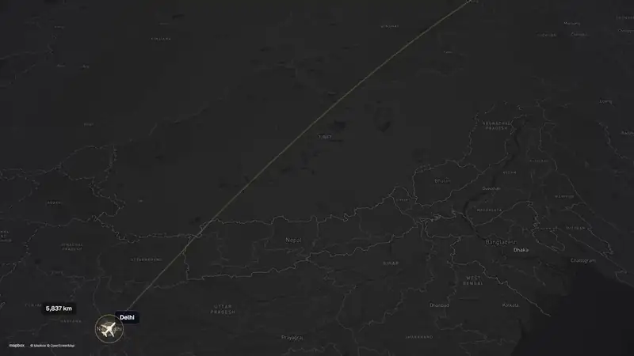
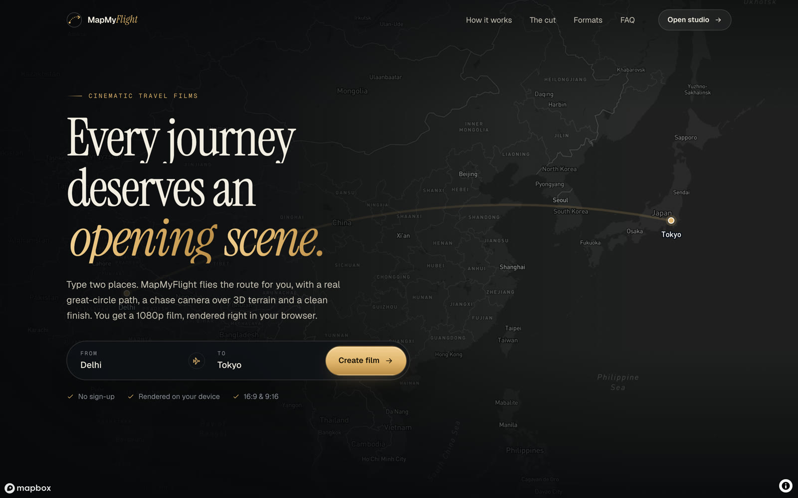
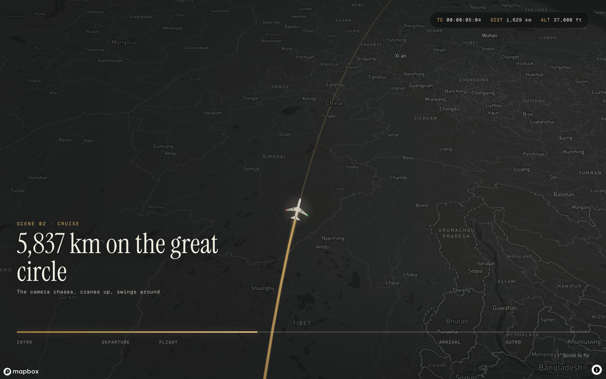
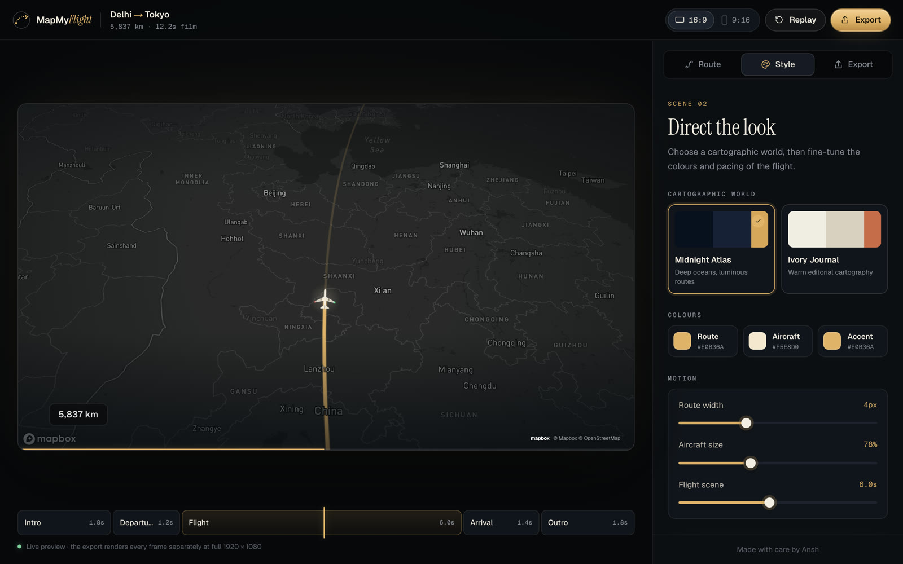
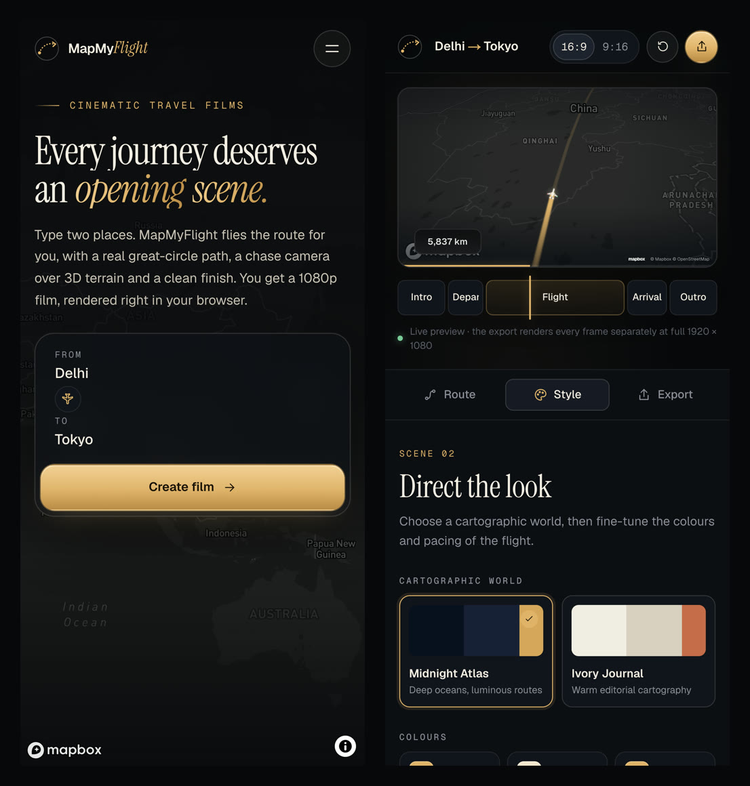
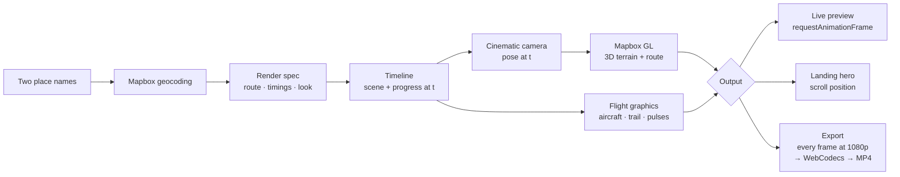

<div align="center">

<a href="https://mapmyflight.anshbhatt.space">
  
</a>

# MapMyFlight

**Cinematic flight-route films, made in your browser.**
Type two places. Get a 1080p video of the flight between them: a true great-circle route,
a 3D chase camera over real terrain and a clean finish. Free, no sign-up, nothing uploaded.

[**Live site**](https://mapmyflight.anshbhatt.space) · [**Open the studio**](https://mapmyflight.anshbhatt.space/studio) · [How it works](#how-it-works) · [Run it locally](#getting-started)




<sub>A real export, Delhi → Tokyo, straight out of the studio.</sub>

</div>

---

## Features

- **Any two places on Earth.** Search with live suggestions; the route is drawn as a true great circle, the way aircraft actually fly.
- **A camera with intent.** One continuous move, no cuts: a wide establishing shot, a push-in on the origin, a chase over 3D terrain that cranes up at cruise and swings around the aircraft, a push-in for touchdown, then a pull-back to the whole route in gold.
- **An aircraft that feels alive.** It banks into turns, casts a ground shadow that drifts and softens as it climbs, blinks navigation lights and leaves a glowing trail.
- **Frame-exact 1080p export.** Never a screen recording: every frame is rendered at full resolution and encoded on your device as **MP4 (H.264 via WebCodecs)** or **WebM**.
- **Wide or vertical.** 16:9 for YouTube and decks, 9:16 for Reels, Shorts and TikTok. The vertical cut recomposes the shot; it isn't a crop.
- **Two cartographic worlds.** *Midnight Atlas* or *Ivory Journal*, plus your own route, aircraft and accent colours and a flight scene from 3.5 to 9 seconds.
- **Private by design.** Only the place names you type go to Mapbox for geocoding. The film is rendered and encoded in your browser and never leaves your device.

## Screenshots

<table>
  <tr>
    <td width="50%"></td>
    <td width="50%"></td>
  </tr>
  <tr>
    <td><sub><b>Landing page.</b> The hero is the real engine, rendered live.</sub></td>
    <td><sub><b>Scroll to fly.</b> Scrolling drives the camera, with a live timecode, distance and altitude HUD.</sub></td>
  </tr>
  <tr>
    <td colspan="2"></td>
  </tr>
  <tr>
    <td colspan="2"><sub><b>The studio.</b> Live preview, a scene timeline that follows playback, and Route · Style · Export panels.</sub></td>
  </tr>
  <tr>
    <td colspan="2" align="center"></td>
  </tr>
</table>

## How it works

The whole film is a **pure function of time**. Given a render spec (the route, timings, look and aspect ratio) and a timestamp, the engine computes exactly one frame. That is why the live preview, the scroll-driven landing hero and the exported video always match.



| Piece | Where | What it does |
| --- | --- | --- |
| Timeline | [`lib/timeline.ts`](lib/timeline.ts) | Splits the film into intro, departure, flight, arrival and outro, and eases the aircraft along the route. |
| Camera | [`lib/cinematic-camera.ts`](lib/cinematic-camera.ts) | One continuous camera move blended through smoothsteps, so there are no snaps between scenes. |
| Flight graphics | [`lib/flight-graphics.ts`](lib/flight-graphics.ts) | Draws the aircraft, shadow, nav lights, trail and airport pulses on a canvas, shared by preview and export. |
| Map scene | [`lib/flight-scene.ts`](lib/flight-scene.ts) | Route lines, markers, labels, 3D terrain and fog in Mapbox GL. |
| Exporter | [`lib/local-render-provider.ts`](lib/local-render-provider.ts) | Steps through every frame off-screen at full resolution and encodes H.264 with WebCodecs (muxed with `mp4-muxer`), or WebM via `MediaRecorder`. |

## Tech stack

- **[Next.js 16](https://nextjs.org)** (App Router, Turbopack) with **React 19** and **TypeScript**
- **[Mapbox GL JS 3](https://docs.mapbox.com/mapbox-gl-js/)** for the map, 3D terrain and geocoding
- **[GSAP 3](https://gsap.com)** with ScrollTrigger, SplitText and DrawSVG for the landing page motion
- **WebCodecs** + **[mp4-muxer](https://github.com/Vanilagy/mp4-muxer)** for in-browser H.264 export
- **[Turf.js](https://turfjs.org)** for distances
- **Tailwind CSS 4** as the base layer, with hand-written design tokens in [`app/theme.css`](app/theme.css)
- Fonts: **Geist**, **Geist Mono** and **Instrument Serif**

## Getting started

**Requirements:** Node.js 20.9 or newer and a free [Mapbox access token](https://account.mapbox.com/access-tokens/).

```bash
git clone https://github.com/ansh-logics/MapMyFlight.git
cd MapMyFlight
npm install
cp .env.example .env.local   # then paste your Mapbox token into it
npm run dev
```

Open [http://localhost:3000](http://localhost:3000) for the landing page and [http://localhost:3000/studio](http://localhost:3000/studio) for the editor.

### Environment variables

| Variable | Required | Description |
| --- | --- | --- |
| `NEXT_PUBLIC_MAPBOX_TOKEN` | Yes | Public Mapbox token (`pk.…`) for the map, place search and exports. |
| `NEXT_PUBLIC_SITE_URL` | No | Canonical URL used for metadata, the sitemap and social previews. Defaults to `https://mapmyflight.anshbhatt.space`. |

### Scripts

| Command | Description |
| --- | --- |
| `npm run dev` | Start the development server. |
| `npm run build` | Create a production build. |
| `npm run start` | Serve the production build. |
| `npm run lint` | Run ESLint. |
| `npm run to-mp4 -- input.webm [output.mp4]` | Convert a WebM export to MP4 with ffmpeg, for browsers without H.264 WebCodecs. |

## Project structure

```
app/
├── page.tsx                 Landing page
├── studio/                  The editor (/studio)
├── opengraph-image.tsx      Social preview, rendered at build time
├── icon.tsx, apple-icon.tsx Brand icons
├── robots.ts, sitemap.ts, manifest.ts
├── theme.css                Shared design tokens
└── landing.css, globals.css
components/
├── landing/                 Hero, How it works, The cut, Formats, Features, Footer
├── studio/                  Studio app and place search
├── ui/                      Icons and logo
└── Map.tsx                  Live preview
lib/                         Engine: timeline, camera, flight graphics, map scene, exporter
assets/fonts/                Fonts used to render the social preview (SIL OFL)
docs/media/                  Images for this README
```

## Browser support

| | Preview | MP4 export | WebM export |
| --- | :---: | :---: | :---: |
| Chrome / Edge (recent) | ✅ | ✅ | ✅ |
| Safari | ✅ | Depends on WebCodecs H.264 support | ✅ |
| Firefox | ✅ | Depends on WebCodecs H.264 support | ✅ |

The studio detects H.264 support at runtime and falls back to WebM automatically. Everything needs WebGL. Visitors who prefer reduced motion get a calm, static landing page.

## Deploying

MapMyFlight is a standard Next.js app with no server-side secrets beyond a public Mapbox token. Deploy it to [Vercel](https://vercel.com/new) (or any Next.js host), set `NEXT_PUBLIC_MAPBOX_TOKEN` and `NEXT_PUBLIC_SITE_URL`, and you're done. Every route, including the social image, sitemap and icons, is pre-rendered at build time.

## Credits

- Map data © [Mapbox](https://www.mapbox.com/about/maps/) © [OpenStreetMap contributors](https://www.openstreetmap.org/copyright). Exports keep this attribution in the frame, as the terms require.
- [Instrument Serif](https://github.com/Instrument/instrument-serif) and [Geist](https://github.com/vercel/geist-font) are licensed under the SIL Open Font License; copies are in [`assets/fonts`](assets/fonts).

---

<div align="center">
<sub>Made with care by <a href="https://github.com/ansh-logics">Ansh</a>.</sub>
</div>
